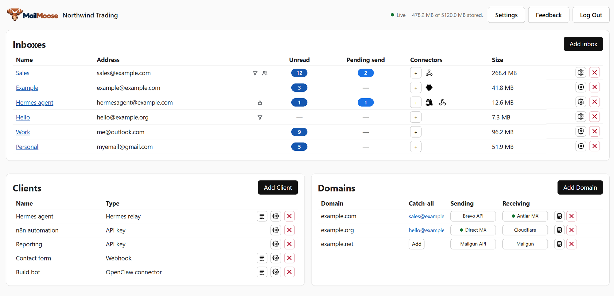

<div align="center">


# MailMoose

**Self-hosted email for AI agents and automations. Your inboxes, your infrastructure, your control.**

MailMoose brings email into one self-hosted platform for AI agents, automations, and applications. Create inboxes on your own domains or connect existing Gmail, Outlook, and IMAP mailboxes, all through a single web interface and API.

Give agents and automations scoped access to read, search, draft, and send email, with optional human approval before messages go out.

Deploy in a single Docker container, bring your own email providers, and integrate with Hermes, OpenClaw, webhooks, or the REST API.

[Quickstart](#quickstart) · [Receiving providers](#receive-email-your-way) · [Agent connectors](#connect-your-agent) · [Documentation](#documentation)

**Public beta** · Open source · Self-hosted

[](https://github.com/dellarb/mailmoose/actions/workflows/ci.yml) [](LICENSE)



</div>

## Why MailMoose?

### 1. Your email, your infrastructure, your way

Run a complete email platform in a **single self-hosted container**, with a built-in web interface and no complicated mail server stack.

Create inboxes on **your own domain** or connect **existing mailboxes**. Choose from a wide range of receiving and sending providers, or run your own.

One platform for email, whether it's for AI agents, automations, applications, or everyday use.

### 2. Give agents email access, with sending permissions you control

Create an **assistant API key** that lets agents read messages, search email, and prepare drafts without permission to send directly.

Keep sending subject to your approval, or give trusted agents direct sending permissions.

### 3. Review agent-written drafts wherever you work

Choose how you review and send agent-generated emails:

- **Drafts folder:** Agents place drafts in your mailbox, ready for you to review, edit, and send.
- **Email approval:** Receive an approval request by email. Approve or reject, and MailMoose automatically sends approved messages.

### 4. Receive email on your own domain, without opening ports

**Antler MX** receives email for your domain and forwards it to MailMoose without opening inbound SMTP ports.

Simply configure your DNS records and start receiving. Or use your own MX receiver or third-party provider.

## Receive email your way

MailMoose supports multiple receiving methods, giving you the flexibility to use existing infrastructure or start from scratch.

| Receiving option | Best for |
| --- | --- |
| **Antler MX** | Receive email for your own domain without opening inbound SMTP ports |
| **Mailgun, Cloudflare Email Routing, Resend, Postmark** | Connect existing inbound email providers |
| **Direct MX** | Receive email directly into MailMoose over SMTP |
| **Remote MX / Dial MX** | Run your own separate or shared receiving server |
| **Gmail, Outlook, IMAP** | Connect existing mailboxes without moving your email |

For outbound email, bring your own Mailgun, Brevo, Resend, SMTP relay, or direct sending configuration.

See the [email providers guide](docs/EMAIL_PROVIDERS.md).

## Quickstart

Run MailMoose with **one Docker Compose file**. No repository checkout or separate `.env` file required.

**1. Create `docker-compose.yml`:**

```yaml
services:
  mailmoose:
    image: ghcr.io/dellarb/mailmoose:latest
    restart: unless-stopped
    environment:
      ADMIN_EMAIL: "admin@example.com"
      ADMIN_PASSWORD: "replace-with-a-strong-password"

      # Optional but strongly recommended: run `openssl rand -hex 32`
      # and uncomment the next line, pasting the generated key.
      # APP_ENCRYPTION_KEY: "paste-generated-key-here"

      #Optional but strongly recommended to configure a proper URL behind reverse proxy.
      #Many sender settings depend on this value - it must be real URL you use to access mailmoose.
      #BASE_URL: "https://mail.example.com"
    volumes:
      - ./data:/data
    ports:
      - "8081:8081"
```

Set your administrator credentials and change `BASE_URL` to the address you'll use. For local-only testing without a reverse proxy, use `http://localhost:8081`.

`APP_ENCRYPTION_KEY` is optional: when omitted, MailMoose creates one automatically at `./data/encryption_key`. If you supply a key, **back it up separately from `./data`** and keep it unchanged after connecting providers. Whichever key is in use must be retained to decrypt saved provider credentials.

**2. Start MailMoose:**

```bash
docker compose up -d
```

Open your configured URL and sign in. Add your domain or connect an existing mailbox, configure receiving and sending, create inboxes, and connect your agent.

For external access, place MailMoose behind an **HTTPS reverse proxy**. Direct SMTP receiving requires an additional port mapping (`25:2525`) and setup; a separate provider webhook hostname may require port `8082`. See the [self-hosting guide](docs/SELFHOSTING.md).

## Connect your agent

MailMoose works with AI agents, automations, and applications through multiple integration methods.

- **Hermes Relay:** Connect Hermes agents through an authenticated, outbound WebSocket connection. Receive events in real time without exposing the agent to the internet.
- **OpenClaw:** Connect OpenClaw using the included relay-based channel plugin.
- **Webhooks:** Deliver incoming messages and mailbox events to your own service.
- **REST API:** Read messages, search history, manage drafts, request approvals, and send email with appropriate permissions.

### Agent-friendly by design

Give your agent a MailMoose URL and API key. MailMoose provides built-in discovery, setup instructions, permission information, and a machine-readable API.

```text
/.well-known/mailmoose   Agent discovery
/agent                   Agent setup guide
/v1/bootstrap            API key permissions
/openapi.json            OpenAPI specification
```

See the [agent connector guide](docs/CONNECTORS.md).

Domain and connected inboxes share the same native message schema and mailbox
API. Follow `next_cursor` with `before` for lists, threads and search; inspect
label capabilities and authoring settings rather than branching on inbox type.
See the [API capability matrix](docs/API.md#shared-contract-and-provider-capabilities)
for deliberate provider limits, including remote body availability and deletion.

## Documentation

| Guide | Covers |
| --- | --- |
| [Email providers](docs/EMAIL_PROVIDERS.md) | Inbound, outbound and standalone mailbox configuration |
| [Agent connectors](docs/CONNECTORS.md) | Hermes, OpenClaw, webhooks and API integration |
| [Self-hosting](docs/SELFHOSTING.md) | Deployment, TLS, backups, security and upgrades |
| [Remote MX](docs/REMOTE_MX.md) | Antler MX, Dial MX and separate receivers |
| [API](docs/API.md) | Endpoints, permissions, drafts and events |
| [Decisions](docs/DECISIONS.md) | Architecture decisions and their rationale (maintainers) |

## Contributing

MailMoose is open source. Contributions, bug reports and documentation improvements are welcome.

See [CONTRIBUTING.md](CONTRIBUTING.md) for contribution guidelines and [SECURITY.md](SECURITY.md) for reporting vulnerabilities.

## License

MailMoose is licensed under the **GNU Affero General Public License v3.0 (AGPL-3.0)**.
