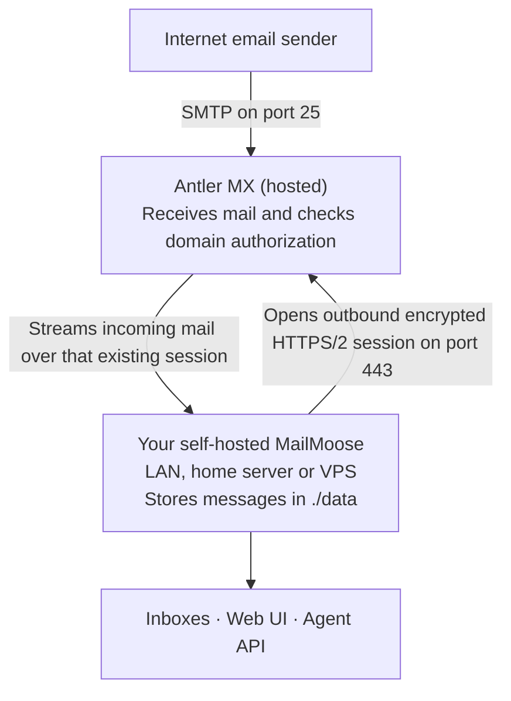

# Email providers

Use this guide to set up receiving, sending, or an existing mailbox in MailMoose.

| Setup | Where to configure it |
| --- | --- |
| Receive mail on your domain | **Domains → Receiving** |
| Send mail from your domain | **Domains → Sending** |
| Connect an existing mailbox | **Add inbox → Standalone inbox** |

Domains can inherit their parent's sending and receiving settings. Provider credentials are encrypted using `APP_ENCRYPTION_KEY`.

To run a separate SMTP receiver yourself, see [Remote SMTP receiving](REMOTE_MX.md).

## Inbound: Direct MX

**Direct MX** receives email directly over SMTP using the receiver bundled with
the standard MailMoose deployment. In the domain's **Receiving** panel, choose
**Direct MX** and save. The setup panel shows the SMTP hostname; publish the
domain's MX records to that hostname and publish SPF for your sending policy.

The standard Compose deployment includes the receiver, but you must
publish host port 25 (`25:2525`) for public SMTP delivery. Then select **Direct
MX** for each domain that should receive mail. Direct MX is not enabled for a
domain merely by opening the port. A webhook-only deployment does not need the
port-25 mapping.

A system administrator can use a separate receiver instead of the bundled one.
That deployment is documented in [Remote SMTP receiving](REMOTE_MX.md#direct-mx-with-a-separate-receiver).

## Inbound: Antler MX

**Antler MX is a hosted SMTP receiver for your domain.** It is included as a receiving option in MailMoose. You do not need to run another container, open inbound SMTP ports, or expose MailMoose's web interface to the internet.

### How it works



MailMoose makes an **outbound connection** to the hosted Antler receivers. Antler accepts incoming SMTP and passes messages to MailMoose over that connection. MailMoose handles the inbox and stores the messages locally. Antler is a receiving relay, not a hosted mailbox or an outbound sending service.

### Set it up

1. Add your domain in MailMoose and create an inbox.
2. Open the domain's **Receiving** settings and select **Antler MX**.
3. Enter a contact email and save. This is for receiver operations, not a mailbox login.
4. Copy the **MX** and `_mailmoose-mx.<domain>` **TXT** records shown in the setup panel into your domain's DNS. Use the actual values provided by MailMoose.
5. Wait for the **DNS** and **receiver** status indicators to show ready.
6. Send a test email to an address on your domain.

The TXT record proves that you authorized this MailMoose installation to receive mail for the domain. Antler also checks that your domain's MX records point to its receiver. The setup panel identifies missing or incorrect DNS records.

**No inbound ports are needed on your MailMoose host for Antler MX.** The host does need outbound HTTPS access to Antler. If your instance is offline, Antler cannot deliver into it and the sending mail server must retry; Antler is not a mailbox or a durable mail queue.

To send outbound mail, configure a separate provider under the domain's **Sending** settings.

## Inbound: Mailgun

1. Add and verify the receiving domain in Mailgun, including the MX records Mailgun provides.
2. On the dashboard, click **Receiving** for the domain and choose **Mailgun**.
3. In Mailgun, open **Send → Receiving**, select the domain's region, and click
   **Create route**. Choose **Match Recipient**, matching every address at this
   domain only. Enable **Forward** and paste the URL shown at that step in
   MailMoose (with its adjacent copy button), for example:

```text
https://your-host.example/internal/ingest/mailgun/raw-mime
```

4. Click **Create Route**. This is an inbound Route, not an event webhook.
5. Open **API Security** from Mailgun's profile menu and copy the **HTTP webhook
   signing key**, not an API key or domain sending key. Paste it into MailMoose
   and save. The secret is stored encrypted on the domain, not read from the
   environment. Send a test email to confirm delivery.

MailMoose resolves the recipient to its logical inbox. A configured domain catch-all handles unmatched local parts. The `raw-mime` suffix is protocol-significant: it selects raw MIME delivery. The legacy `/internal/ingest/mailgun` alias has been removed.

## Inbound: Cloudflare Email Routing

1. In MailMoose, open the domain's **Receiving** panel, choose **Cloudflare
   Worker**, and save. MailMoose displays a ready-to-deploy Worker and its
   one-time secret. Copy the code before closing the setup page; regenerate the
   secret if needed.
2. In Cloudflare, create a Worker from the Hello World template, replace its
   code with the MailMoose-generated code, and deploy it.
3. Enable Email Routing for the domain and apply the DNS records Cloudflare
   provides.
4. In **Email Routing → Routing rules**, configure the catch-all rule to send
   mail to the Worker and enable it.
5. Send a test message and verify it appears in the intended MailMoose inbox.

A single Worker can serve an apex domain and its onboarded subdomains. Add each
subdomain to Cloudflare Email Routing and to MailMoose; when offered, choose to
inherit the parent provider configuration. The subdomain still has its own
MailMoose inboxes and routing. For a private MailMoose instance, the Worker must
be able to reach its public webhook URL; Cloudflare Workers cannot call private
network addresses. See [Cloudflare's Email Routing guide](https://developers.cloudflare.com/email-routing/).

## Inbound: Resend

Resend sends a signed notification to MailMoose, which fetches the original
message from Resend. Use an API key with **Full access**; a sending-only key
cannot read received mail.

1. Verify the domain in Resend and apply its inbound MX records.
2. In MailMoose, open the domain's **Receiving** panel and choose **Resend**.
   Copy the webhook URL shown there.
3. In Resend, create a webhook for that URL and subscribe to **`email.received`**.
   Copy the webhook signing secret.
4. Return to MailMoose, enter the full-access API key and signing secret, then
   save.
5. Send a test message and confirm it appears in the intended inbox.

If several domains use the same Resend webhook, configure its signing secret and API key for each domain.

## Inbound: SendGrid

SendGrid inbound is not available pending end-to-end testing. It is not offered in the provider selector.

## Inbound: Postmark

1. In Postmark, point the receiving domain (a dedicated subdomain is
   recommended) to `inbound.postmarkapp.com` with priority 10.
2. Open the Server's **Inbound Message Stream → Settings** and enable **Include
   raw email content in JSON payload**.
3. In MailMoose, open the domain's **Receiving** panel, choose **Postmark**, and
   save. MailMoose generates a webhook username and password and displays the
   complete webhook URL once.
4. Copy that URL into the Postmark Inbound Message Stream's webhook field and
   save. Regenerate the credentials in MailMoose if the URL is lost or exposed,
   then update Postmark with the replacement.
5. Send a test message and confirm it appears in the intended inbox.

Postmark does not sign inbound webhooks. Its credentials authenticate the
webhook caller, not the envelope sender; see the relevant note in
[SECURITY.md](../SECURITY.md). Postmark is inbound-only; choose a separate
sending provider.

## Outbound

Sending is configured per domain. Open a domain's page, choose a **Sending**
provider, and fill in the fields it asks for (for example Brevo only needs an
API key). Each domain owns its own configuration. A domain with no sending
provider queues mail until one is configured, and removing a provider pauses
sending for that domain only.

### Provider requirements

- **Mailgun:** enter the API key and sending domain shown in the Mailgun account.
- **Brevo:** enter an API key and verify the sender address with Brevo.
- **Resend:** enter an API key and verify the sending domain with Resend.
- **SMTP:** enter the relay hostname, port, credentials and connection security
  requested by the form.
- **Direct MX:** no relay credentials are used. The operator must be able to
  send directly to recipient mail servers on port 25.

### DKIM signing

For Direct MX, open the domain's **Sending → Direct MX** panel and enable DKIM
signing. Publish the TXT record shown there at
`mailmoose._domainkey.<domain>`. Receivers cannot validate the signature until
DNS contains that record. Turning signing off removes the key; messages already
queued are not changed.

## Standalone mailbox providers

These options connect an existing mailbox to a MailMoose standalone inbox. The
provider remains the source of truth for its mail. The setup steps below explain
how each supported provider connects.

## Google / Gmail

Use **Add inbox → Standalone inbox → Google / Gmail**. Each connected inbox
uses your own Google Cloud OAuth client. The Google mailbox remains the source
of truth; MailMoose keeps a metadata index and fetches message bodies and
attachments when opened.

### Create your Google app

1. In [Google Cloud Console](https://console.cloud.google.com/), create or
   select a project and enable the [Gmail API](https://console.cloud.google.com/apis/library/gmail.googleapis.com).
2. In [Google Auth Platform](https://console.cloud.google.com/auth/overview),
   configure the app. Choose **External** for a personal Gmail account; choose
   **Internal** only for accounts in your Google Workspace organisation.
3. Keep the app in **Testing** and add the exact mailbox address as a test user.
   Do not publish an unverified app that requests Gmail access.
4. Under **Data Access**, add the Gmail `gmail.modify` scope and the `openid`
   and `userinfo.profile` scopes, then save.
5. Create a **Web application** OAuth client. Add the exact redirect URL shown
   by the MailMoose setup wizard, for example:

   ```text
   https://mail.example.com/ui/oauth/google/callback
   ```

6. Enter the client ID and secret in the MailMoose wizard, connect the account,
   and approve access. If Google shows an unverified-app warning, choose
   **Advanced → Go to <app name>** while the app remains in Testing.

The callback is based on `BASE_URL`; use a hostname and scheme accepted by Google.
Your browser must be able to reach the MailMoose callback. A raw LAN IP or
`.local` hostname is not suitable for a registered production callback.

### Personal Gmail and troubleshooting

For personal Gmail, a Google OAuth app in Testing is the practical setup until
Google's verification process is complete. Google expires Testing authorizations
after seven days, so reconnect from the inbox settings when prompted. Publishing
an unverified app does not remove that limit and can block access instead.

- For `redirect_uri_mismatch`, copy the exact URL shown in the MailMoose wizard
  into the OAuth client's authorised redirect URIs.
- For an access/verification block, return the app to **Testing** and check that
  the mailbox address is listed as a test user.
- If access expires or is revoked, reconnect the same Google account from the
  inbox settings; the inbox itself is retained.
- If the final callback page does not load, leave the wizard open and use its
  **Callback failed? Paste the return URL** option. Do not share that URL.

### Mailbox behaviour

Gmail system labels supply Inbox, Sent, Drafts, Spam and Trash views. Archive
removes the Inbox label; a message can appear in multiple user-label views.
Search runs against Gmail, and new mail is detected by polling rather than push
notifications. Bodies and attachments are fetched on demand rather than stored as
a full-message archive. Permanent deletion is not available from this connector.

References: [Web OAuth](https://developers.google.com/identity/protocols/oauth2/web-server)
and [Gmail scopes](https://developers.google.com/workspace/gmail/api/auth/scopes).

## Microsoft / Outlook

Connect a personal or shared Microsoft mailbox with **Add inbox → Standalone
inbox → Microsoft / Outlook**. MailMoose connects through Microsoft Graph; the
mailbox remains the source of truth.

### Set up Microsoft sign-in

Self-hosters can register a Microsoft Entra public-client application and set
`MICROSOFT_CLIENT_ID` and `MICROSOFT_TENANT_ID` on the MailMoose deployment. Use
`common` for work/school and personal accounts, or a tenant ID/domain to restrict
the app to one organisation. Add the `http://localhost` mobile/desktop redirect
URI; no client secret is used. Required delegated permissions are
`User.Read`, `Mail.ReadWrite`, `Mail.Send`, and `offline_access`.

For shared mailboxes, enable `Mail.ReadWrite.Shared`, `Mail.Send.Shared`, and
`User.ReadBasic.All` in the app registration. Your organisation may require
admin consent. The signed-in user must also have delegation to the shared mailbox;
sending requires Send As or Send on Behalf permission.

### Connect a mailbox

1. Choose **Add inbox → Standalone inbox → Microsoft / Outlook**.
2. Select **Personal Inbox only** or **Personal Inbox and Shared Inbox**. Shared
   permissions must be selected before sign-in.
3. Sign in and approve access. Microsoft redirects to `http://localhost`; this
   is expected even though no local web server is running.
4. Copy the complete final URL from the sign-in window and paste it into the
   MailMoose wizard. The URL is sensitive; do not share it.
5. For a shared connection, choose the mailbox from the picker or enter its
   address if it is not listed.

Connections remain limited to the mailbox selected during setup. Reconnect from
that inbox's settings if Microsoft access expires or is revoked.

### Mailbox behaviour and new-mail delivery

MailMoose presents Outlook folders and categories in the standalone inbox. Normal
Inbox and Archive folders are supported; Microsoft's separate Online Archive
mailbox is not. Outlook keeps its Sent Items copy. Some send or reply outcomes
can be uncertain; do not repeat a send unless the inbox confirms it failed.

Personal Outlook.com and Microsoft 365 inboxes can receive near-real-time change
notifications after initial setup. The MailMoose callback path
`/internal/ingest/microsoft/notifications` must be reachable over HTTPS at the
configured receiving URL (`DEDICATED_RECEIVER_URL`, or `BASE_URL` when unset).
If notifications are unavailable, MailMoose polls instead. Shared mailboxes use
polling; their sync schedule in inbox settings determines how quickly new mail is
noticed.

## One / Gmail

Choose **Add inbox → Standalone inbox → One (Easy Gmail Setup)**, enter your One
REST API key, and select the Gmail mailbox or mailboxes to import. Choose the
history window that suits each inbox; importing a large history uses One's
account-wide request allowance. The key is not shown again after setup.

MailMoose accesses Gmail through One's cloud service. Existing and new mail are
synced on a schedule (One does not provide push notifications); the default poll
interval is five minutes and can be changed in the inbox's own sync schedule.
The mailbox remains in Gmail, while MailMoose keeps a local metadata index and
fetches message content when needed.

The setup screen only creates inboxes. Each imported inbox owns its own encrypted
copy of the key: to replace or reconnect that key, open the inbox and use
**Identity → Advanced → Reconnect Gmail via One**. A revoke or expiry in One flags
every affected inbox, and each is reconnected on that inbox. An address that is
already configured cannot be imported again — delete the existing inbox first,
which is also the only way to remove a One connection (nothing is ever revoked or
deleted in One or Gmail). Protect `APP_ENCRYPTION_KEY` as described in the
[self-hosting guide](SELFHOSTING.md#backup).

## IMAP + SMTP

Choose **Add inbox → Standalone inbox → IMAP + SMTP** to connect a mailbox from
another email host. Enter the email address, IMAP hostname, port, username,
password (or app password), and the security mode required by your host. TLS is
the default; use STARTTLS or plaintext only when your provider requires it and
you understand the network-security implications. The sync root is optional and
defaults to `INBOX`.

Outbound SMTP is optional. Add its hostname, port, username, password, and
security mode if MailMoose should send mail through that mailbox. Without an
outbound server, the inbox can still receive and read mail but cannot send from
the connected account. Use the provider's documented server names and ports;
MailMoose does not guess them. Connection credentials are encrypted with
`APP_ENCRYPTION_KEY`.
